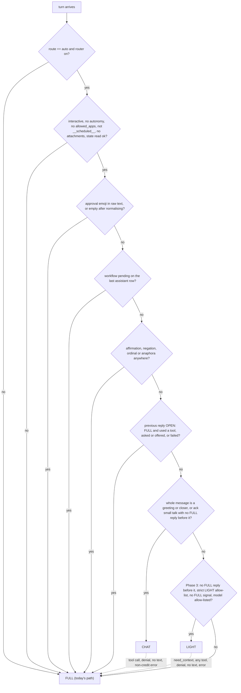

# Turn-cost plan: automatically trim prompts, tools and reasoning on turns that don't need them

**Status:** proposal, nothing implemented · **Date:** 2026-10-07 · **Target file:** `docs/architecture/TURN_COST_PLAN.md`

**Why this plan exists:** a bare "hi" cost **16,016 tokens / $0.0100** on `moonshotai/kimi-k3` and **17,738 tokens / $0.0018** on `gemini-3.5-flash-lite`.

**How it was built:** a 7-area read of the codebase, three candidate designs, and three adversarial reviews (safety, code accuracy, cost maths). Each review point was checked against the working tree before it was applied; the verification notes at the end list the outcome of every point.

**The design in one line:** a deterministic per-turn router sends greetings and closers to a separate tool-free path with no dispatch code. Phase 3 adds an optional strict path for general-knowledge questions. Everything else, and every case of doubt, runs today's full path.

**Method:** all token counts are offline `tiktoken o200k_base` measurements, taken with the network blocked and `HERMES_DISABLE_DB=1`. No provider API was called. Every code claim has a `file:line` anchor checked against the working tree on 2026-10-07. Dollar figures use the app's **placeholder** price table, so they show what the app would compute, not what a provider bills.

---

## 1. Why a "hi" costs ~16k tokens

**Input is 95–98% of the bill.** Working back from the footer figures with the rates in `hermes/models.py:117,130` (cost is shown with `toFixed(4)`, `static/app.js:323`):

| Model | Input tokens | Output tokens (incl. reasoning) | Input share of cost |
|---|---|---|---|
| kimi-k3 | 15,785–15,836 | 180–231 | ~95% |
| flash-lite | 17,485–17,738 | 0–253 (the footer only bounds it) | ≥94% |

**The default scope is the most expensive one.** When no business is picked, the web chat uses `active_business="all"` (`app.py:567`, `app.py:680`). In that scope a required `business` enum is added to most tools.

**Breakdown of a first "hi"** ("All Businesses" scope, Context on, Apps on):

| Component | Tokens (o200k) | Sent on "hi" today? | After this plan ("hi" → CHAT) | Anchor |
|---|---|---|---|---|
| **Tool schemas**, 31 OpenAI-format functions | **12,462–13,914** (compact to default JSON); 10,398–11,601 with one business locked | Yes, on every provider call | **0** | built `hermes/agent.py:888` via `hermes/tools.py:143`; converted `hermes/agent.py:377-399`; sent `hermes/agent.py:658` |
| ↳ `maton_request` (Notion, Zoom/zoom-admin and Jira recipes) | 2,094 | yes | 0 | `hermes/tools.py:457-560` |
| ↳ 8 WATI tools, appended unconditionally | ~1,650–2,550 | yes, even though `wati` is not in local `HERMES_APPS` (`.env:28`) | 0 | `hermes/tools.py:998-1012`, `hermes/tools.py:1357-1366` |
| ↳ `business` enum ('all' scope only) | 2,391 | yes | 0 | `hermes/tools.py:412-455` |
| ↳ scheduled-task tools, `create_artefact`, `set_guardrail` | ~2,900–3,200 | yes | 0 | `hermes/tools.py:1064-1286` |
| ↳ `approval_token` property copied into 10 schemas | ~500 | yes | 0 | `hermes/tools.py:1288-1301` |
| **Base system prompt** (rich, no scope) | 1,314 | yes | replaced by `LITE_CHAT`, **93** | `hermes/agent.py:210-289` |
| ↳ GROUNDING & ATTRIBUTION | 315 | yes | **kept on every turn that offers a dispatchable tool** | `hermes/agent.py:266-286` |
| ↳ confirm-before-write / approval_token paragraph | 203 | yes | **kept** (same rule) | `hermes/agent.py:239-250` |
| ↳ tool-specific how-tos | ~558 | yes | kept on FULL turns | `hermes/agent.py:217-265` |
| Business-scope paragraph | 52 ('all') / 87 (locked) | yes | 0 | `hermes/agent.py:290-305` |
| Global context pack + header | 1,568, measured from `HERMES_CONTEXT_PACKS.md`; the DB copy may differ | **Only if the `context_packs` table exists.** `docs/project/PROJECT_CONTEXT.md:22` (2026-07-27) says it did not exist in production; not re-checked since. There is no small-talk check either way. | 0 | `hermes/agent.py:306-311`, `hermes/context_packs.py:56-81` |
| Business pack (locked scope only) | 187–1,220 | when locked and the table exists | 0 | `hermes/context_packs.py:64-68` |
| Memory block (always tier + semantic top-K) | 0–2,000 (est.); an in-code measurement says 1,880 | yes. The semantic tier has **no minimum score** and K is 8 locally (`.env:172`). | 0 | `hermes/agent.py:312-320`, `hermes/memory_retrieve.py:55-62,65-123` |
| RAG block | 0 in 'all'; ~660 when locked (**inferred**: header plus 6 full hits, so every hit cleared 0.30) | locked scope only | 0 | `hermes/rag.py:202-236` (returns early for 'all' at `:215-216`), `hermes/config.py:416`, `hermes/context_mode.py:13` |
| Past-conversation recall | 0 (`HERMES_CONVO_MEMORY` is off locally) | no | 0 | `hermes/conversation_retrieve.py:64-102` |
| Attachments ledger | 0 unless files were shared | no | 0 | `hermes/agent.py:160-174`, `hermes/agent.py:970` |
| History | 0 on the first turn; +20–60 on a second "hi" | — | only the trailing run of CHAT exchanges | `hermes/db/conversations.py:127-157` |
| Output incl. reasoning (Kimi) | 180–231, worked back from the footer | `reasoning_effort: "max"` is hard-coded | unchanged until Phase 2.3; est. 30–100 at "low" | `hermes/agent.py:139-142` |
| Output (flash-lite) | 0–253, worked back from the footer | no reasoning control is sent | unchanged | `hermes/agent.py:708-720` |
| **Hidden:** post-turn memory-extraction LLM call | ~700–1,000 in + ≤800 out (est.) on `GUIDANCE_MODEL` (diffusiongemma, NIM-only); the app prices it at $0.00007–0.00034 | yes, on every non-empty turn | **skipped** | `app.py:586-589`, `app.py:714-717`; `hermes/memory_extract.py:111-124,150-158`; `hermes/models.py:129,253-258` |
| **Hidden:** embedding calls | 1 in 'all' (memory only; RAG returns before embedding); 2 when locked; 3 with recall on | yes | **0** | `hermes/memory_retrieve.py:83`; `hermes/rag.py:91,215-216`; `hermes/conversation_retrieve.py:83` |
| **Hidden:** DB / Pinecone | ~7–9 small queries before the provider call in 'all' (history read twice, model and context settings, owner memory ×2, attachments, pack on a cache miss); ~10–13 plus 1 Pinecone query when locked | yes | one history+state read | `app.py:562`, `hermes/agent.py:883-901`, `hermes/memory_retrieve.py:75-90`, `hermes/agent.py:970` |
| **Total input** | modelled 15,396–16,848 before memory; measured request body 17,104 (pack included, no memory). The observed Kimi input was 15,785–15,836. | — | **121 measured** (155 for a voice turn), ~130 with the provider's chat template | — |

Seven facts behind the table:

1. **The only lever today is all-or-nothing.** `rich_context = context_mode.enabled()` decides the tools, the retrieval blocks and the prompt variant together (`hermes/agent.py:887-888`, `hermes/agent.py:923`, `hermes/agent.py:997`). Nothing decides per turn.
2. **The Apps toggle does nothing.** `hermes/apps_access.py:39-46` exists, and its endpoints are at `app.py:403-423`. But `hermes/agent.py` imports only `context_mode` (`hermes/agent.py:27`).
3. **Reasoning effort only reaches Claude, and it is mis-sized there.** `resolve_effort()` picks "low" for "hi" (`hermes/agent.py:537-568`). But `_openai_turn` has no effort parameter (`hermes/agent.py:634-642`), the call site passes none (`hermes/agent.py:1018-1020`), and Kimi is pinned to "max" (`hermes/agent.py:141`). On Claude, "Hi!", "thanks!" and "good morning" resolve to "medium": punctuation defeats the prefix match (`hermes/agent.py:531-556`), "good morning" is not in the low-hint list (`hermes/agent.py:516-519`), and `.env:13` sets the default to medium.
4. **There is no explicit prompt caching, and implicit cache hits are not recorded.** There is no `cache_control`, and `system` is one plain string (`hermes/agent.py:604-611`). OpenAI and Gemini cache long prefixes automatically, and calls 2..N of a FULL turn resend a byte-identical tools+system prefix (`hermes/agent.py:994-998`). The OpenAI-protocol path never reads `cached_tokens` (`hermes/agent.py:741-743`), so a "today" cost for a multi-call business turn may overstate the real bill.
5. **The in-code estimate is inconsistent.** `hermes/context_mode.py:6-13` cites ~19,950 tokens for a greeting, but the parts it lists add up to 16,999. It was measured with a locked business, so it includes RAG and a business pack.
6. **The o200k model is at least 8% above Kimi's observed input** (17,104 measured without memory, against 15,785–15,836 observed with memory). Either Kimi tokenizes more tightly, or the context pack is not present in production (fact 1 above; `docs/project/PROJECT_CONTEXT.md:22`). Phase 0.0 and the Phase 0.5 telemetry will settle which.
7. **A greeting can be re-billed on Claude.** Gemini's free-tier 429 wording ("exceeded your current quota … billing") matches `_CREDIT_PHRASES` (`hermes/credits.py:43-53`). That benches the model, and the turn is retried on the first available model in `_fallback_order()` (`hermes/agent.py:1062-1070`, `hermes/models.py:345-354`). That model is Claude Haiku 4.5, since `MODEL_OPTIONS` lists it first (`hermes/models.py:24-28`). A full-size "hi" then costs ~$0.018 on Haiku and more on Opus. How often this happens is unmeasured (see §5 and B21).

---

## 2. Design

### In plain language

Before anything expensive is built, a deterministic router decides how much each **interactive chat** turn needs. It is pure Python, makes no model call, and takes about 10–110 µs per decision in the prototype. It looks at three things: the raw user text, the persisted state of the previous assistant reply, and who is calling.

| Tier | When | What is sent | What is stripped |
|---|---|---|---|
| **CHAT** (Phase 1) | The **whole** message is a greeting or closer after normalising ("Hi!", "thanks", "hiii", "good morning"). Nothing is pending, and the previous reply was not an open FULL reply (rule 5 below). | The ~93-token `LITE_CHAT` prompt (+33-token `VOICE_LITE` on voice), the current message, and at most the 2 previous CHAT exchanges as plain text. **No tools.** | All tool schemas; the rich prompt; pack, memory, RAG, recall and the attachments ledger; every retrieval embedding and DB/Pinecone lookup; FULL-turn history; reasoning where it can be switched off; post-turn memory extraction. |
| **LIGHT** (Phase 3, shadow first) | An exact, published allow-list of general-knowledge shapes (§4, step 3.2). It runs only on a new chat or after a CHAT/LIGHT reply, with no FULL signal in the text, and only on allow-listed models. | The `LITE_GENERAL` prompt plus one non-dispatchable `need_context` tool (~100 tokens). | Same as CHAT. If the model calls `need_context` (or anything else), the turn reruns as FULL. |
| **FULL** | Everything else, and any doubt. | Today's payload, apart from the reviewed Phase 2 trims. | Nothing beyond the Phase 2 trims. |

The cheap tiers run in a **separate generator** (`_chat_turn` / `_light_turn`). It contains **no tool-dispatch code** and buffers all text until the provider's final event. The buffered output is discarded and the turn reruns on the normal FULL path, with usage from both calls summed, when the model:

- emits any tool call;
- replies with a denial ("I can't check your…");
- hits the token cap with no text; or
- raises a non-credit error.

A **credit or quota error** on a CHAT call works differently: CHAT is retried once on `models.active_model()`. Escalating would put a 17k-token FULL turn on the fallback model, which is the expensive path described in fact 7.

**Why this design**

- **Allow-list, not deny-list.** CHAT matches a closed set of whole messages. A "short messages go cheap" rule leaked 6 of 24 business phrases in measurement.
- **Previous-reply aware.** Approvals are often given only in prose (DELETE, `delete_scheduled_task`, full-autonomy tasks) and leave no pending metadata. So any reply to an open FULL turn goes FULL, however friendly it sounds.
- **Isolated history.** CHAT and LIGHT never see a FULL reply, so business figures never sit under a prompt without GROUNDING.
- **Opt-in by caller.** Only the two chat endpoints pass `route="auto"`. Scheduled runs, meeting notes, scripts and tests keep today's path.

### Router rules, in order (first match wins)

This is the **single** rule set to implement. The prototype in `%TEMP%/hermes_router_proto/turn_router.py` differs from it: there, affirmations match only as the whole message or its prefix; "great", "cool" and "perfect" are CHAT-eligible; "again", "all" and "too" are fillers; and greetings after a question still go to CHAT. The prototype must be brought in line, and the phrase suites re-labelled, before any accuracy number is quoted for this design (see §6 and the appendix).

1. **Bypass → FULL.** Any of:
   - the flag is off, or `route != "auto"`;
   - `interactive=False`, `autonomy` is set, or `allowed_apps` is set;
   - the session key starts with `__scheduled__:`;
   - attachments are present (`hermes/agent.py:522-528`, `hermes/agent.py:898`);
   - the state read failed. This needs an explicit flag, because Postgres `get()` returns `[]` on error (`hermes/db/conversations.py:148-150`).
2. **Raw-text checks, before normalising → FULL.** Either:
   - the message contains an approval emoji (U+1F44D thumbs up, U+1F44C OK hand, U+2705/U+2714/U+2611 check marks, U+1F197 OK, U+1F4AF, U+1F64F, U+1F91D);
   - or the message is empty after normalising (emoji-only or punctuation-only).
3. **Hard pending → FULL.** The last assistant row's `metadata.tool_calls` shows an open workflow:
   - `awaiting_confirmation: true` (written at `hermes/agent.py:1154-1160`, persisted at `hermes/db/conversations.py:252-260`);
   - `email_with_attachment` without `confirm`;
   - `maton_create_connection`.
4. **Approval-ish words anywhere → FULL, always.**
   - Affirmations and negations: yes, yeah, yep, ok, okay, sure, fine, go ahead, do it, proceed, confirm, approve, send, done, no, nope, cancel, stop, wait, not now, sounds good, looks good.
   - Ordinals: first, second, #2, "the … one".
   - Anaphora: it, that, this, them, same, again, also.
   - So "ok thanks", "thanks for that" and "hello again" go FULL. That costs money, never safety.
5. **Open previous reply → FULL.** The last assistant row is not CHAT/LIGHT-routed (or carries no route, as with rows written before this feature) **and** any of these holds:
   - it used any tool;
   - its text ends in `?`, or its last 400 chars match the confirm/offer pattern (`confirm|approve|go ahead|proceed|shall i|should i|do you want|would you like|want me to|which (one|business|task|account|file|option)|reply (yes|with)|let me know|ok to|are you sure`);
   - its `stop_reason` (persisted at `hermes/db/conversations.py:255`) is not `end_turn`;
   - its reply is `(no response)` (`hermes/agent.py:1247`).

   This also covers nudges: "hello?" after a failed or truncated reply goes FULL.
6. **CHAT allow-list.**
   - **Normalise first:** NFKC, lowercase, strip punctuation and emoji, collapse letters repeated 3+ times, at most 8 words.
   - **Greetings and closers:** the whole message must be a greeting (hi, hello, hey, good morning/afternoon/evening, gm, salaam, habari, how are you, …) or a closer (thanks, thank you, thx, ty, cheers, bye, good night, …). Allowed fillers: "hermes", "there", "buddy", "so", "very", "much".
   - **Acknowledgement small talk** ("great", "perfect", "cool", "nice", "awesome") goes to CHAT only when there is no previous assistant row or it was CHAT-routed. After any FULL reply it goes FULL, because it can mean approval.
   - The trailing-`?` part of rule 5 does not apply after a CHAT reply. That keeps CHAT history usable even though `LITE_CHAT` replies often end with a question.
7. **Phase 3 only: LIGHT.** All of these must hold:
   - `HERMES_ROUTER_LIGHT=strict`;
   - the model is in `HERMES_ROUTER_LIGHT_MODELS`;
   - there is no previous assistant row, or it was CHAT/LIGHT-routed;
   - the text matches the published allow-list (§4, step 3.2);
   - the text has **none** of these FULL signals:
     - business slugs (`hermes/businesses.py:15-22`) or display names (a new `BUSINESS_DISPLAY_NAMES` constant: businesses.py holds only slugs and lacks `comfort_pca`);
     - app words (`Config.apps()`, `hermes/config.py:358-365`);
     - domain nouns or action verbs;
     - first-person or possessive pronouns;
     - live-data words;
     - emails, URLs, Jira keys, phone numbers, currency, `%`, times or dates;
     - who-questions, or a capitalised word after the first;
     - any digit next to a word (outside pure arithmetic or a whitelisted unit conversion);
     - quote, price, cost, how much, how many, left, remaining, total, explain, delay, status, balance, owe.

   `per` counts as a business slug only as an uppercase token or in a slug position ("for per"), because it is an ordinary English word. A false positive here only costs money.
8. **Otherwise → FULL.**

`_LOW_EFFORT_HINTS` (`hermes/agent.py:516-519`) is **not** reused as router vocabulary. It contains yes, no, ok, list, show me and status: exactly the replies that need tools.

### Draft cheap-tier prompts (measured)

- **`LITE_CHAT`** (93 tokens): "You are Hermes, the user's AI executive assistant. This message is a greeting, thanks or small talk, so it runs without tools, documents, memory or business context. Reply in one or two short, warm sentences. Do not state any fact about the user's businesses, people, money, schedule or accounts, and never claim to have checked anything. If they want something done, invite them to say what. Today's date is …"
- **`VOICE_LITE`** (33 tokens): a spoken-style suffix. It omits `_VOICE_STYLE`'s "confirm a write action" line (`hermes/agent.py:147-157`), which would contradict having no tools.
- **`LITE_GENERAL`** (174 tokens before this revision; **re-measure**, Phase 3). Answer from general knowledge only, and call `need_context` **first** for anything about the user's data, current information or any action. **Never** give a price, cost, amount or quantity estimate, and never state business specifics.

### Hard invariants (never stripped)

1. **The rich prompt goes on every turn that offers ≥1 dispatchable tool (a `LOCAL_TOOLS` member, `hermes/tools.py:1369-1380`) or any business data block.** It carries:
   - GROUNDING & ATTRIBUTION (`hermes/agent.py:266-286`);
   - the truncation-honesty rule (`hermes/agent.py:262-265`);
   - the confirm-before-write / approval_token paragraph (`hermes/agent.py:239-250`);
   - business isolation (`hermes/agent.py:251-253`);
   - the business-scope note whenever `active_business` is set (`hermes/agent.py:290-305`);
   - the caveat headers on the pack and memory blocks (`hermes/agent.py:306-320`).

   LIGHT's `need_context` is not dispatchable. A test asserts that it is the *only* tool LIGHT sends.
2. **Standing rules travel with tools.** Every turn that offers ≥1 dispatchable tool also carries the global pack's **Hard rules** and **Security** sections (`HERMES_CONTEXT_PACKS.md:68-74,90-91`, 377 tokens) and the always-tier memories (`hermes/memory_retrieve.py:75-78`). They come from the pack and memory blocks when Context is on, and from the standing-rules core (step 0.3) otherwise.
3. **CHAT and LIGHT carry no business data.** No pack, memory, RAG, recall or attachments ledger, and no FULL reply in their history. When FULL later replays a LIGHT reply, it is prefixed "[general-knowledge answer, not checked against your data]".
4. **CHAT and LIGHT can never execute a tool.** Their generator has no dispatch code. Separately, step 0.2 makes the offered tool list the capability boundary in the FULL loop too.
5. **These always go FULL:** approval words, approval emoji, ordinals, anaphora, pending workflows, replies to an open FULL turn, nudges after a failed reply, and attachments.
6. **Unattended callers are never routed.** `route` defaults to `"full"`. This covers `hermes/scheduler.py:378-393`, `hermes/meeting_copilot.py:588`, scripts and tests.
   - Their payload stays byte-identical through Phase 1.
   - The `_auto_effort` fixes apply only under `route="auto"`, so Claude's effort for these callers does not change.
   - Phase 2.1 (schema diet, in the shared `build_tools`) and Phase 3.1 (memory floor) **do** change every FULL payload, unattended ones included. They ship with reviewed golden-snapshot diffs.
7. **The business lock is untouched** (`app.py:562-567`, `app.py:675-680`). An escalation reruns with the same `active_business`.
8. **`guardrails.check` is unchanged** (`hermes/guardrails.py:456-529`). `turn_index` is computed from the full history before routing (`hermes/agent.py:908`).
9. **Fail-open means fail to FULL.** A router exception, an unreadable state, an unknown flag value or a settings lookup error all give FULL. Flags default to off, and shadow mode comes first. This matches the repo rule (`docs/hermes/HERMES_ALL_TASK_PROMPTS.md:597`) and the D2 pattern (`docs/hermes/HERMES_UPGRADE_PLAN.md:383-395`).

---

## 3. What each example turn gets after the change

"FULL" means today's payload. The Phase 2 trims cut about 0.2–0.8k per call from it.

| Turn | Tier | Why (rule) | Sent | Skipped | ≈ input tokens |
|---|---|---|---|---|---|
| "hi" | **CHAT** on a new chat, after a CHAT reply, or after a closed FULL reply; **FULL** after an open FULL reply | rules 5–6 | `LITE_CHAT`, "hi", and earlier CHAT exchanges only. Thinking is off on Anthropic and the NIM boolean toggles. Kimi stays at "max" until 2.3. | Tools, rich prompt, pack, memory, RAG, recall, embeddings, extraction | **121** (measured) vs ~15.8k |
| "thanks!" | **CHAT** in the same contexts as "hi"; **FULL** if the previous FULL reply used a tool, asked or offered something, failed, or left a workflow pending | rules 3, 5, 6 | Same as "hi" | Same as "hi" | ~125, or unchanged |
| "what is 2+2" | **FULL** in Phases 1–2; **LIGHT** in Phase 3, only on a new chat or after CHAT/LIGHT | rule 7 | Phase 3: `LITE_GENERAL` plus `need_context`; any tool call reruns as FULL | Phase 3: everything except the escape tool | ~315 (measured, before the prompt revision) vs ~15.8k |
| "rent status for GAK?" | **FULL** | business:gak, domain, live | Full tools, rich prompt, scope, pack (if present), memory, RAG | — | ~16.5–18.4k per provider call |
| "send Amal the renewal letter" | **FULL** | action, cap_word, domain | Same as today. The `email_with_attachment` draft → confirm flow is unchanged (`hermes/email_attachments.py:224-289`). | — | unchanged |
| "yes" (after a confirm prompt) | **FULL** | affirmation (rule 4) and pending (rule 3) | Full tool list, so the held tool is present; every rule. `turn_index` comes from the full history. | — | unchanged |
| "the second one" | **FULL** | ordinal and anaphora; the previous turn used a tool | Same as today | — | unchanged |
| *(extra)* thumbs-up emoji or "thanks" + thumbs-up after "Confirm and I'll delete A, B, C." | **FULL** | rule 2 (emoji checked before normalising) and rule 5 (confirm wording, read tool used) | Same as today | — | unchanged |
| *(extra)* "hello?" after a `(no response)` or truncated reply | **FULL** | rule 5 (failed previous reply) | Same as today | — | unchanged |
| Voice turn | Spoken "hi" via STT (`static/voice.js:273-283`) → **CHAT** + `VOICE_LITE`. A Gemini Live relay such as "the user wants their meetings today" → **FULL**. Spoken "yes" → **FULL**. | Relays use third-person possessives and domain/date words; Gemini Live already answers bare greetings itself (`hermes/gemini_live.py:65-73`) | CHAT: 155-token body (measured). FULL: `_VOICE_STYLE` unchanged. | CHAT: as for "hi" | 155 vs ~16k |
| Scheduled run | **FULL, never routed** | `run_turn` is called without `route` (default "full"), with `interactive=False` and `autonomy` set (`hermes/scheduler.py:378-393`) | Byte-identical through Phase 1. `effort=None` keeps the legacy NIM kwargs (Kimi "max", Nemotron budget 16,384, `hermes/config.py:252`). Claude's effort is unchanged because the `_auto_effort` fixes are route-gated. Autonomy gates are unchanged (`hermes/tools.py:84-140`, `hermes/tools.py:2498-2504`). | — | unchanged until 2.1/3.1 |
| Meeting AI notes | **FULL, never routed** | `run_turn(throwaway_session, prompt, voice=False, active_business=…)` with no route (`hermes/meeting_copilot.py:588`) | Byte-identical through Phase 1; Gmail and Drive tools present | — | unchanged until 2.1/3.1 |

---

## 4. Phased implementation

Each step lists files and anchors, the change, the estimated saving, a size (S/M/L) and the test that proves it. After each step lands, run `graphify update .` as `CLAUDE.md` requires.

### Phase 0: measure, then prerequisites (no automatic trimming yet)

#### 0.0 Measure what greetings actually cost (S; owner-run, read-only, $0 API)

- **Files:** new `scripts/_turn_cost_replay.py`. Reads `hermes_messages` (`hermes/db/conversations.py:237-260`), `ai_runs` (`hermes/db/conversations.py:322-351`) and `memories` (`hermes/db/memories.py:220-239`).
- **Change:** run the router prototype's `decide()` over every historical user message, using the real `TurnState` of the assistant row before it. Report:
  - **Spend share:** the would-be CHAT/LIGHT share of turns and of dollars, per model;
  - **Model mix:** how often `model_used` was a Claude model on a conversation configured for Kimi or Gemini (fallback, fact 7);
  - **Business-turn output:** the input/output split of tool-using turns.

  Two read-only SQL checks run alongside:
  - does `context_packs` exist and hold a `global` row (fact 6)?
  - do any `always_inject` memories match greeting/morning/briefing/"when I say" patterns? Those would be greeting-triggered habits that CHAT must not ignore.
- **Saves:** 0. It decides whether Phases 1–4 are worth their size, and settles the pack question.
- **Test:** `tests/test_turn_cost_replay.py` (new) runs the script against synthetic rows.

#### 0.1 Make the test suite truly offline (S)

- **Files:**
  - new `tests/conftest.py`: blocks non-loopback sockets, sets `HERMES_DISABLE_DB=1`;
  - `tests/test_context_apps_toggles.py:162-196`;
  - `tests/test_agent_credit_fallback.py:36-47,72,97,126`.
- **Why:** `hermes/config.py:11` runs `load_dotenv(override=True)`, which loads the real keys.
  - Today the toggle test makes a real but **small** call: Context off gives the plain prompt, on `.env`'s `claude-sonnet-5` (`.env:12`), because `HERMES_DISABLE_DB=1` skips the DB model setting.
  - Once 0.3 makes that test build tools, each run would send a ~16–18k-token turn (≈$0.05 at Sonnet-5 rates).
- **Change:**
  - Stub `_anthropic_turn` and `_openai_turn` in the toggle test, as `tests/test_agent_credit_fallback.py:60-66` does.
  - Make both fake `_openai_turn` signatures (`:72`, `:126`) accept `**kwargs`.
  - Give `_Store` (`:36-47`) a `get_with_state`, or have `stream_turn` fall back to `store.get` via `getattr`.
  - Fix the stale expectation at `:97`: the fallback chain is now anthropic → openai → gemini (`hermes/models.py:345-354`).
  - Owner decision on the two leftover visual tests (`docs/project/PROJECT_CONTEXT.md:233-235` says delete them).
- **Saves:** one real provider call per test run (about $0.05 per run once 0.3 lands).
- **Test (acceptance):** **no new failures** with the network blocked. Today's baseline is 289 passed and 8 failed: 5 toggle tests (fixed by 0.3), 1 stale fallback expectation, 2 visual tests.

#### 0.2 Make the offered tool list the capability boundary (S)

- **Files:** `hermes/agent.py:1102-1107`, `hermes/agent.py:1206-1213`
- **Change:**
  - For each provider call, compute `offered = {t.get("name") for t in tools}`.
  - A `tool_use` whose name is not in `offered`, or not in `LOCAL_TOOLS`, gets `{"type":"tool_result","is_error":true,"content":"Tool <name> is not available on this turn."}`. It never reaches `guardrails.check` or `dispatch`. This also fixes the dangling `tool_use` that today's `continue` leaves behind.
  - **Retry cap:** at most one `is_error` per unavailable name per turn. On a repeat, break the loop with the last assistant text, as today's `break` does. Without the cap, a model that keeps naming an unavailable tool (for example `web_search` on the OpenAI path, where `hermes/agent.py:261` still mentions web search) would resend the ~16k prefix up to `HERMES_MAX_TOOL_ITERATIONS=32` times (`.env:170`).
- **Why:** today the loop runs **any** `LOCAL_TOOLS` name (`hermes/tools.py:1369-1380`), including tools not sent this turn.
- **Saves:** 0 tokens. It is the safety prerequisite for any tool subsetting.
- **Test:** `tests/test_agent_capability_boundary.py` (new). Cases:
  - an unoffered `send_email`;
  - an unknown name;
  - an unoffered name repeated three times, which must produce one `is_error` and then stop, with at most 2 provider calls;
  - spies on `dispatch` and `guardrails.check` that must never be called.

#### 0.3 Finish the Apps/Context split, with a standing-rules core (M)

- **Files:**
  - `hermes/agent.py:27,177-208,885-888,916-925,970,995-998`
  - `hermes/apps_access.py:39-41`
  - `hermes/scheduler.py:376-393`, `hermes/meeting_copilot.py:587-588`
  - `static/context-mode.js:77-90`
  - `tests/test_context_apps_toggles.py:36-59,162-185`
- **Change:**
  - Read `apps_on = apps_access.enabled()` and `ctx_on = context_mode.enabled()` once per turn.
  - **Apps off** (removes capability; ships unflagged): no tools, and the ADVISOR or PLAIN prompt.
  - **Context off with Apps on** (a new state, with tools on and less context): behind **`HERMES_SPLIT_TOGGLES`** (default off). While the flag is off, Context off keeps stripping tools as today.
  - **Standing-rules core.** Whenever ≥1 dispatchable tool is offered and the pack block is empty, inject:
    - the global pack's Hard rules and Security sections (`HERMES_CONTEXT_PACKS.md:68-74,90-91`, 377 tokens), taken from the loaded global pack, or from a static fallback constant when the table is empty;
    - plus the owner_always and business_always memory rows. These are query-independent and need no embedding (`hermes/memory_retrieve.py:75-78`).

    Context off then drops only semantic memory, RAG, recall and the rest of the pack body. Why this matters: tools on with the pack off would otherwise lose the "money only from live QuickBooks", "tenant outreach is email-only", fee and Security rules. Those exist nowhere in the rich base prompt (`hermes/agent.py:210-305`).
  - **`_system_prompt` gains `rich_context`** and produces four variants:

    | Apps | Context | Variant | Content |
    |---|---|---|---|
    | on | on | RICH | today's prompt (+ core if the pack is empty) |
    | on | off | RICH without blocks | GROUNDING, write-confirm, truncation, scope, **standing-rules core** |
    | off | on | ADVISOR | identity, GROUNDING, scope, blocks with caveat headers, plus "apps access is switched off in Settings; you cannot look anything up or act" |
    | off | off | PLAIN | reworded so it no longer blames business context (test marker `"apps access is switched off"`, `tests/test_context_apps_toggles.py:37`) |

  - **Flatten history for no-tool variants.** Whenever `tools == []` (ADVISOR, PLAIN, CHAT), convert `tool_use`/`tool_result` blocks in replayed history to text. The in-memory store replays raw blocks (`hermes/memory.py:57-67`), and `_anthropic_turn` sends `tools=[]` alongside them (`hermes/agent.py:605-611`). Anthropic rejects that pairing. The rule is known from the API docs but not verified live; Context off on the in-memory store has the same exposure today.
  - **Unattended callers** (owner decision §8 Q2). The scheduler and meeting notes ignore the Context switch and always get full context. When Apps is off, they return an explicit `skipped: Apps access is off` result. `generate_ai_notes` passes `interactive=False, autonomy="readonly"` (B19) so it is recognisable as unattended.
  - Update the UI off-texts to describe whichever behaviour is live.
- **Saves:** nothing automatic. Turning Apps off by hand now saves 10.4–13.9k tokens per call while keeping memory.
- **Test:**
  - Fixes the 5 failing toggle tests; the context-off/apps-on case sets `HERMES_SPLIT_TOGGLES=on`.
  - New `tests/test_prompt_invariants.py`: a matrix over apps × context × voice × business (None/'all'/locked) × pack present/absent. Whenever a dispatchable tool is sent, assert `GROUNDING & ATTRIBUTION`, `_truncation`, `approval_token`, `Hard rules` and `Security`. Assert the scope note only when `active_business` is set.

#### 0.4 Effort plumbing with no behaviour change; route-gated `_auto_effort` fixes (S)

- **Files:** `hermes/agent.py:119-143,505-568,571-612,634-726,1013-1021`; `hermes/config.py:135-151`
- **Change:**
  - **`_anthropic_turn(..., light=False)`.** When `light` is set, omit `thinking` and `output_config`. That is the same request shape the API already accepts on the Haiku/continuation branch (`hermes/agent.py:601`). Today there is no way to switch thinking off for a non-continuation call.
  - **`_openai_turn(..., *, effort=None, light=False)`.** With the defaults it sends exactly today's kwargs. That is the regression boundary.
  - **`light=True` needs no flag for already-proven values.** It sets the NIM boolean thinking toggles to False and `reasoning_budget` to 0: the values the continuation path already sends (`hermes/agent.py:684-705`).
  - **Untested values sit in a `_REASONING[model][low|medium|high]` map** and are sent only when `HERMES_PROVIDER_EFFORT=on` (after the 2.3 probe). That covers Kimi, gpt-oss and gpt-5.x `reasoning_effort`, and any Gemini value.
  - **400 fallback.** A 400 mentioning `reasoning_effort`, `thinking` or `chat_template_kwargs` adds the model to `_NO_REASONING_KNOB` and retries once with legacy kwargs. The 400 arrives before any chunk, so nothing has been emitted.
  - **`_auto_effort` fixes, applied only when `route="auto"`:**
    - strip punctuation and emoji before the LOW match;
    - add good morning/afternoon/evening and gm to the LOW hints;
    - match HIGH hints on a **leading** word boundary only (`\b` + hint). Stems such as `analyz`, `strateg`, `diagnos` and `optimi` keep matching, while "explanation" and "remodel" stop.

    Unattended callers keep today's matcher.
- **Saves:** 0 by itself. It enables CHAT with reasoning off (Phase 1) and Kimi "low" (2.3), and stops medium-effort thinking on "Hi!" for Claude chat.
- **Test:** `tests/test_agent_effort.py` (new):
  - captured kwargs for every model × {effort None, light, light+flag}, with `effort=None` byte-identical to today;
  - the 400 fallback;
  - route auto: "Hi!", "thanks!" and "good morning" → low; "explanation" and "remodel" → not high; "analyze my P&L", "strategy" and "optimize" → high; "history" → not low;
  - route full: today's outputs, including a meeting-notes prompt titled "Strategy sync".

#### 0.5 Per-turn token and model telemetry (S)

- **Files:**
  - `hermes/agent.py:741-743` (usage parse), `hermes/agent.py:994-998`, `hermes/agent.py:1035-1043`, `hermes/agent.py:1062-1070`, `hermes/agent.py:1244-1255`
  - `hermes/db/conversations.py:252-260`, `hermes/db/conversations.py:322-351`, `hermes/db/conversations.py:466-477`
  - `static/app.js:319-328`
- **Change:** the `done` result gains these fields:
  - `breakdown`: estimated tokens for system base, scope, pack/core, memory, recall, RAG, ledger, voice suffix, tools and history. Computed as chars/4 and scaled to the first call's real `input_tokens`.
  - `calls`: a per-call list `{model, provider, input, output, reasoning, cached, fallback: bool}`. This makes the request count and the Claude fallback visible (fact 7).
  - `reasoning_tokens` and `cached_tokens`, read via `getattr` from `completion_tokens_details` / `prompt_tokens_details`. Cached tokens are subtracted from input **only** for models with a confirmed non-zero `cache_read` rate; the Gemini and NIM rates are `0.0` placeholders (`hermes/models.py:112-131`).
  - Shadow-evaluation proxies: which blocks were non-empty, and whether the reply overlaps with the prior assistant text.

  Persist all of it in message metadata and in `ai_runs`. Show it in the `renderUsage` tooltip with 6 decimals, because `toFixed(4)` (`static/app.js:323`) shows $0.00005 as $0.0001.
- **Saves:** 0. Every later saving gets verified in production instead of estimated.
- **Test:** `tests/test_usage_capture.py` (new):
  - a fake usage chunk carrying reasoning and cached tokens;
  - the breakdown keys sum to within ±15% of a stubbed `input_tokens`;
  - a mid-turn credit fallback records two models with `fallback: true`.

#### 0.6 One read for history plus conversation state, and persist before `done` (S)

- **Files:**
  - `hermes/db/conversations.py:127-157` (get), `hermes/db/conversations.py:159-182` (the `attachments()` pattern), `hermes/db/conversations.py:252-260` (meta)
  - `hermes/memory.py:57-67,93-123`
  - `hermes/agent.py:901-908`
  - `app.py:697-713`
- **Change:**
  - **New `store.get_with_state(key) -> (messages, TurnState)`.**
    - **`TurnState`** holds `ok`, `last_assistant_text`, `last_tool_calls`, `last_stop_reason`, `last_route`, `trailing_chat_exchanges` and `user_turns`. Any exception sets `ok=False`.
    - **Postgres:** extend the existing SELECT to also project `metadata->'tool_calls'`, `->'route'` and `->'stop_reason'` per row, plus a scalar subquery counting `role='user'` rows (served by `messages_session_idx`, `hermes/db/migrations/0001_init.sql:148`).
    - **In-memory:** derive the state from the transcript's last assistant entry (`hermes/memory.py:115-123`), which already stores `tool_calls`. Extend `record_turn` to also store `stop_reason` and `route`. Use the **same** `pending_from(meta)` detector as Postgres, so the backends cannot diverge.
  - **Stream endpoint ordering.** `/api/chat/stream` yields `done` before `store.record_turn` runs (`app.py:697-713`), so a fast follow-up can read stale state. Call `record_turn` before yielding the `done` payload; extraction and the record-turn write stay after it.
  - `turn_index` stays as it is today (the B5 fix is separate).
- **Saves:** 0 (an enabler).
- **Test:** `tests/test_turn_state.py` (new). Cases:
  - a raising cursor → `ok=False`;
  - each pending kind (guardrail, draft, oauth) is detected;
  - Postgres and in-memory give identical `TurnState` for the same transcript;
  - the stream endpoint persists before `done` (TestClient with an ordering-recording fake store).

### Phase 1: the CHAT tier (biggest safe win)

#### 1.1 `hermes/turn_router.py` (M)

- **Files:** new `hermes/turn_router.py`; knobs in `hermes/config.py:135-151`.
  - Vocabulary comes from:
    - slugs in `hermes/businesses.py:15-22`;
    - a new `BUSINESS_DISPLAY_NAMES` constant (Afro Farm, GAK Properties, GIF Properties, GAK Commodities, Nour Hammam, Personal & Family, Comfort PCA);
    - `Config.apps()` and the app labels (`hermes/config.py:24-41,358-365`), so a newly added app automatically forces FULL.
- **Change:** `decide(RouterInput) -> Decision(tier, reason_codes, pending_kind, affirmation)`, implementing the §2 rules. It is pure and wrapped in `try/except → FULL`. The LIGHT rules exist but are off.

  | Knob | Default |
  |---|---|
  | `HERMES_ROUTER_MODE` (off / shadow / on) | off |
  | `HERMES_ROUTER_CHAT_MAX_TOKENS` | 1024 (applied only where reasoning is off on the CHAT call; see 1.2) |
  | `HERMES_ROUTER_LITE_HISTORY` / `_CHARS` | 2 / 600 |
  | `HERMES_ROUTER_EXTRA_TERMS` (extra proper nouns that force FULL) | empty |
  | `HERMES_ROUTER_SHADOW_SAMPLE` (share of would-be-CHAT turns that also run the CHAT call in shadow) | 0.0 |

  Log one JSON line per decision: tier, **reason category codes only** (`business`, `app`, `cap_word`, `pending:guardrail`, …), word count and a session hash. Never the message text or the matched substring; the prototype's reasons today include names such as `proper_noun:Nairobi`.
- **Saves:** n/a (logic only).
- **Test:** `tests/test_turn_router.py` (new).
  - Port the 196 prototype phrases, **re-labelled to the §2 rules**.
  - The safety subset must be 100% FULL: approvals, emoji approvals, "thanks" + emoji after a prose-only delete confirm, replies after a question or tool turn, ordinals, pending states, nudges after a failed reply, empty-after-normalising, and every bypass.
  - A monkeypatched exception gives FULL.
  - A log-content test asserts that no message token appears in the log line.

#### 1.2 `_chat_turn` generator with no dispatch code (M)

- **Files:** `hermes/agent.py:146-208` (add `LITE_CHAT`, `VOICE_LITE`), `hermes/agent.py:571-612`, `hermes/agent.py:634-726`, `hermes/agent.py:978-992`
- **Change:**
  - **Provider call.** `_anthropic_turn(..., tools=[], light=True)` or `_openai_turn(..., tools=[], light=True)`; `tools=[]` is sent as `NOT_GIVEN` (`hermes/agent.py:658`).
  - **Output cap.** `HERMES_ROUTER_CHAT_MAX_TOKENS` applies only where reasoning is off on the CHAT call (Anthropic, NIM boolean-toggle models, gpt-4o-mini). Kimi, gpt-oss and Gemini stay uncapped until 2.3. NIM bills reasoning against `max_tokens` (`hermes/agent.py:697`), and a stream that runs out reports `max_tokens` with no text (`hermes/agent.py:812-819`). With a cap, Kimi at "max" could therefore escalate on every greeting and cost more than today.
  - **History:** only the trailing run of CHAT-routed exchanges, flattened to text, at most 2 × 600 chars. That means none on a new chat and none after any FULL reply.
  - **Output handling:** text is buffered until `_final`; thinking events are dropped.
  - **Escalation:** discard the output and fall through to the unchanged FULL path, seeding `usage_totals` and `cost_usd` with the CHAT call (`hermes/agent.py:978-990`). Triggers: any `tool_use`, a denial match, `max_tokens` with no text, or a non-credit exception.
  - **Credit errors:** a credit or quota error **retries CHAT once** on `models.active_model()` instead of escalating to FULL.
  - **Store and result:** `store.set` (a no-op on Postgres). The `done` result gains `route={mode, tier, final, escalated, reason_codes}`. The frontend ignores unknown fields (`static/app.js:614-615`).
- **Saves:** "hi" input **~15.8k → ~130 on Kimi** and **~17.6k → ~150 on flash-lite**. Also all retrieval work: 1 embedding call in 'all' scope (2 locked), ~7–9 DB queries in 'all' (10–13 plus 1 Pinecone locked).
- **Test:** `tests/test_stream_turn_tiers.py` (new), with stubbed providers. Cases:
  - a CHAT "hi" sends no tools and the `LITE_CHAT` prompt;
  - Anthropic CHAT kwargs carry no `thinking` / `output_config`; the Kimi CHAT call carries no `max_tokens`;
  - `build_memory_block`, `packs_for`, `build_context_block`, `build_history_block`, `vector_store.embed` and `build_tools` are monkeypatched to raise and are never called;
  - history is ≤2 text-only messages;
  - a stub emitting `send_email` escalates, and the `dispatch` spy is not called;
  - a credit error retries CHAT, not FULL;
  - usage sums across calls.

#### 1.3 Wire `route="auto"` into the chat endpoints only (S)

- **Files:**
  - `hermes/agent.py:856-865` and `hermes/agent.py:1258-1267`: add a `route="full"` keyword.
  - `hermes/agent.py:883-908`: reorder to normalise content → `has_attachments` → `get_with_state` → `turn_index` → `decide()`, then either `_chat_turn` or the existing path. Move `build_tools` (`hermes/agent.py:888`) below the decision.
  - `app.py:571`, `app.py:695`: pass `route="auto"`.
  - `tests/test_api.py:36-42`: `_fake_run_turn` gains `route=None` (or `**kwargs`) and returns a `route` dict. Without that, every `/api/chat` test gets a TypeError and a 500.
- **Change:** shadow mode logs the decision and always runs FULL.
- **Saves:** activates 1.2.
- **Test:**
  - `tests/test_api.py` asserts both endpoints pass `route="auto"`;
  - spies show `scheduler.run_task` and `generate_ai_notes` pass no `route`;
  - in shadow mode the provider receives the FULL payload while `result.route.tier == "chat"`;
  - golden snapshots: FULL bodies for 'all' and 'nh' are byte-identical to today.

#### 1.4 Skip hidden post-turn work and persist the route (S)

- **Files:** `app.py:584-593`, `app.py:712-721`, `hermes/agent.py:834-853`, `hermes/db/conversations.py:252-260`, `hermes/memory.py:115-123`
- **Change:**
  - Read the tier as `final = (result.get("route") or {}).get("final")`. `_credits_result` (`hermes/agent.py:834-853`) builds a result with no `route`, and a bare `result["route"]` would 500 `/api/chat` after the reply was computed (that code sits outside the try at `app.py:569-574`).
  - Also add `route` (final "full") to `_credits_result`.
  - Skip `extract_async` when `final` is "chat" or "light". The LIGHT allow-list excludes first-person text, so a LIGHT turn carries no user facts.
  - `record_turn_async` is skipped too. It is already a no-op unless `HERMES_CONVO_MEMORY_WRITE` is on (`hermes/config.py:458`, `hermes/conversation_write.py:73-75`).
  - Persist `meta.route`.
- **Saves:** one background extraction call per greeting (~700–1,000 in, ≤800 out; the app prices it at $0.00007–0.00034; NIM-only, so likely $0 in real money) and one NIM request. The retrieval savings are credited to 1.2.
- **Test:** additions to `tests/test_api.py`:
  - `final == "chat"` → no background calls;
  - `final == "full"` → both;
  - a result with no `route` (a credits result) goes through both endpoints without a KeyError.

#### 1.5 Kill switch with an endpoint (S)

- **Files:** new `hermes/auto_trim.py`; `app.py`, next to `:379-423` (new `GET/POST /api/settings/auto-trim`)
- **Change:** a dedicated reader. With a DB, it returns **False on any exception** and ignores the per-process override. `Flag.enabled()` would instead return a stale `_override` after a DB error (`hermes/settings_flag.py:53-66`), keeping the router on in a worker after another worker turned it off. Without a DB, it uses the process value, documented as per-process only.
- **Test:** `tests/test_auto_trim.py` (new):
  - a raising DB → False, even after `set_enabled(True)` in the same process;
  - an endpoint round-trip.

#### 1.6 Shadow, then on (S, ops)

- **Change:**
  - Set `HERMES_ROUTER_MODE=shadow` with `HERMES_ROUTER_SHADOW_SAMPLE=0.1`. On 10% of would-be-CHAT turns this also runs and discards the CHAT call, so the escalation rate is measured before go-live.
  - Before turning CHAT on, check 0.0's greeting-habit query. If any always-inject memory is greeting-triggered, force FULL for those greetings or carry the rule in `LITE_CHAT`.
  - Then set `HERMES_ROUTER_MODE=on` **and** `auto_trim_enabled=true`, after the §6 bar is met.
- **Expected "hi":** Kimi ≈ $0.0100 → ≈ $0.0005–0.0007; flash-lite ≈ $0.0018 → ≈ $0.00005–0.00012.

### Phase 2: trim the FULL turn and cheaper reasoning on CHAT

#### 2.1 Content-preserving schema diet (S)

- **Files:**
  - `hermes/tools.py:1292-1301`: shorten the `approval_token` description to one line. The full protocol already arrives in the guard tool_result (`hermes/agent.py:1140-1153`).
  - `hermes/tools.py:473-528`: inline the Notion and zoom-admin recipes in `maton_request` only when that app is in `effective_apps` (`hermes/tools.py:169`).
  - `hermes/tools.py:463`: drop the repeated slug list. It is already in the `app` description (`hermes/tools.py:176`) and the system catalog (`hermes/agent.py:214-215`).
- **Deliberately kept:**
  - the WATI tools (§8 Q1);
  - the RESPONSE SIZE / truncation text (`hermes/tools.py:543-549`);
  - the `business` enum and its prose (§8 Q12);
  - every system-prompt how-to.
- **Note:** `build_tools` is shared, so this also changes scheduler and meeting-notes payloads. Review those golden diffs explicitly.
- **Saves:** ≈0.2k per FULL call always (approval_token ≈105, slug dedupe ≈79, measured), plus ≈0–0.6k depending on `HERMES_APPS`. It is ≈0.6k on the local `.env` and ≈0 on the code default (`hermes/config.py:358-365`).
- **Test:**
  - golden snapshots show only the intended diffs, including the unattended callers;
  - `approval_token` stays on every `APPROVAL_TOKEN_TOOLS` member;
  - the `business` enum is still required in 'all' scope;
  - the prompt-invariant matrix still passes.

#### 2.2 One embedding per turn (S–M)

- **Files:** `hermes/agent.py:914,929-966`; `hermes/memory_retrieve.py:65-85`; `hermes/rag.py:202` → `federated_search(query_vector=…)` (`hermes/rag.py:54-58`); `hermes/conversation_retrieve.py:69` (already accepts a vector)
- **Change:** compute one memoised query vector and pass it to memory, RAG and recall.
  - Build the query from the **typed text** (excluding inlined files, via `_is_attachment_block`; today `latest_text` includes them, `hermes/agent.py:340-342,914`).
  - **But** when the typed text is under ~6 words and a text attachment is present, append the first ~1–2k chars of the attachment. Otherwise a file-only upload would embed an empty query: memory skips the semantic tier (`hermes/memory_retrieve.py:80-90`) and RAG returns "" (`hermes/rag.py:210-212`).
- **Saves:** 0 calls in 'all' scope with recall off (memory is the only embed); 1 call when locked; 2 with recall on. Prompt tokens change only on attachment turns.
- **Test:** `tests/test_single_embedding.py` (new):
  - exactly one `embed` call with memory, RAG and recall on;
  - a file-only upload still produces a non-empty query.

#### 2.3 Reasoning control for CHAT (S; two owner-run probes)

- **Files:** new `scripts/_probe_reasoning_params.py` (owner-run, never CI); `.env.example`
- **Change:**
  - **(a) Acceptance probe.** One "Say OK" call per model × value, with `max_tokens` 16. About 35 calls, ≈ $0.0007–0.0018 at placeholder rates. It only proves that a value is accepted: NIM counts reasoning against `max_tokens` (`hermes/agent.py:697`), so every value shows ≤16 reasoning tokens.
  - **(b) Savings probe.** `LITE_CHAT` + "hi", `max_tokens` 1024, 3 runs per value, recording `reasoning_tokens`. ≈ $0.01–0.03 at placeholder rates.
  - Then fix the `_REASONING` map and set `HERMES_PROVIDER_EFFORT=on` for CHAT (and later LIGHT) only, and give Kimi a CHAT cap. FULL turns keep today's reasoning.
- **Saves:** Kimi CHAT "hi" output ~180–231 → est. 30–100, about $0.0003 per greeting.
- **Test:** `tests/test_agent_effort.py` with the probed values; a 400 still falls back to legacy kwargs.

#### 2.4 Replace the placeholder prices (S, owner input)

- **Files:** `hermes/models.py:112-131`
- **Change:** enter the confirmed rates for Kimi on NIM and for Gemini flash-lite. Until then every dollar figure here is the **app's** number, not the provider's bill.

### Phase 3: LIGHT tier, retrieval floors, and a FULL-reasoning experiment

#### 3.1 Calibrate retrieval floors (M, owner-run, cents)

- **Files:**
  - new `scripts/calibrate_retrieval_thresholds.py`;
  - `hermes/memory_retrieve.py:55-62` (new `MEMORY_SEMANTIC_MIN_SCORE`, default 0 = today);
  - `hermes/config.py:416` (RAG 0.30), `hermes/config.py:445` (recall 0.35).
- **Why:** the thresholds were tuned for `text-embedding-3-small`, but the local `.env:105-107` uses `gemini-embedding-001`.
- **Change:** embed ~40 labelled phrases (small talk vs business) and set the floors from the score distributions. First check that memories embedded with the old model are re-embedded or filtered by `embed_model`. The always tier is untouched.
- **Saves:** **only on locked-business turns that look like small talk**: memory −0.2 to −1.5k and RAG up to −0.66k per call (est.). On a genuine business question the relevant hits should pass, so the saving is **≈0**.
- **Guard metric:** `search_business_knowledge` calls per FULL turn, before and after. Roll back if it rises: one extra tool round trip (+16.5–18.4k) cancels the floor savings of many turns.
- **Test:** `tests/test_memory_min_score.py` (new): rows below the floor are dropped; the default of 0 leaves output unchanged.

#### 3.2 LIGHT tier (M), shadow first

- **Files:** `hermes/turn_router.py`; `hermes/agent.py` (`_light_turn`, a sibling of `_chat_turn`)
- **Change:**
  - **Exact allow-list, published in code and here.** Re-run every suite against it before shipping. It replaces the prototype's wider list, which let "explain the delay", "how much is left" and "give me a quote for 20 bags" into LIGHT through its generic `explain|describe X`, `how (much|many) …` and `give me … quote …` patterns.
    1. pure arithmetic: `^(what is |whats |calculate |compute )?[\d\s.+\-*/x×÷^()=]+$`
    2. `^(what is|whats|what are) (a|an) [a-z][a-z\s-]{0,40}$`
    3. `^(define|definition of|meaning of) [a-z][a-z\s-]{0,40}$`
    4. single abstract noun: `^(what is|whats) [a-z-]*(ism|tion|sion|ology|ity|ance|ence|ment|sis|ics)$`
    5. `^what does [a-z0-9\s-]{1,30} (mean|stand for)$`
    6. `^how (do|does) (a |an )?[a-z\s-]{1,40} work$`
    7. `^(translate|how do you say) .{1,80}$`
    8. unit conversion between units on a fixed unit list (currency stays FULL)
    9. `^(tell me|give me) (a |an |another )?(joke|fun fact|riddle)$`
  - **Gating:** LIGHT only in fresh or CHAT/LIGHT context, only with no FULL signal (§2 rule 7), and only on `HERMES_ROUTER_LIGHT_MODELS`, each after a `need_context` smoke test.
  - **Payload:** `LITE_GENERAL` (with the no-estimates clause) plus `need_context(reason)`. When FULL later replays a LIGHT reply, it gets the "[general-knowledge answer, not checked against your data]" prefix.
  - **Output handling:** buffered **until `_final`**, not 240 chars, so an escalation can never show the user two answers (compare the `emitted` guard at `hermes/agent.py:1025,1063`).
  - **Escalation:** discard and rerun FULL on `need_context`, any other tool, a denial, `max_tokens` or an exception. One escalation per turn.
  - Memory extraction is skipped (see 1.4).
- **Known risk:** the earlier prototype leaked 3 of 24 FULL-needing phrases into LIGHT on held-out set 3. A general-knowledge prompt can still state an invented market price, so the no-estimates clause and the price/quantity FULL signals are mandatory.
- **Saves:** "what is 2+2" ≈17k → ≈315 tokens (measured before the prompt revision).
- **Test:** new `tests/test_light_tier.py`:
  - `need_context` → the second call has full tools and the RICH prompt, and history holds no `need_context` blocks;
  - LIGHT never dispatches;
  - fail-open;
  - history isolation;
  - LIGHT is refused after a FULL reply;
  - the replay prefix is applied.

#### 3.3 FULL-turn reasoning experiment (S), a separate measured change

- **Change:** behind `HERMES_FULL_EFFORT_MAP=on`:
  - Kimi medium → "high" instead of "max";
  - Nemotron medium → budget 4,096 instead of 16,384 (`hermes/config.py:252`).
- **Decide with data:** compare `reasoning_tokens` (from 0.5) and an owner quality review before and after.
- **Why it matters:** business-turn output is **unknown** today. If three tool-choosing calls each reason 1–2k tokens at "max", output is 18–36% of a Kimi business turn, and this step may outweigh the Phase 2 diet and the floors.

### Phase 4 (optional; only if 0.0/0.5 show FULL business turns dominate the bill)

- **Lazy tool groups with a `load_tools` meta-tool (L).**
  - Requires 0.2.
  - Saving per turn ≈ N·S − p·C, where N is calls per turn, S ≈ 6–8k saved per call, p the miss rate and C ≈ 10–12k per extra call.
  - For a 3-call turn: no miss gives ≈ −40%; one miss gives ≈ −9%; a model that loads most groups to be safe gives ≈ +20% versus today.
  - Estimate p offline from `hermes_messages.metadata.tool_calls` before building, and keep `maton_request` and `search_business_knowledge` in the core.
  - Make WATI a lazy group rather than deleting it.
  - How-to bullets can follow their tools, except the `email_with_attachment` two-step bullet, which is effectively a confirm-before-write rule.
  - Gate on measured p, not only on ≥9/10 routing accuracy.
- **Anthropic `cache_control` with a static-first prefix (M).**
  - Re-evaluate once 0.5 shows how often Claude actually serves turns, including via fallback.
  - Needs a `cache_creation` term in `price_of` (`hermes/models.py:173-195`).
  - Conflicts with per-turn tool variation: tools are the first cache segment. Never ship both without measuring `cache_creation` against `cache_read`.
- **Global context-pack tiering (M).** Needs owner sign-off, because it removes the People and Related-party maps that attribution depends on.

---

## 5. Projected cost

**All figures are estimates.**

- **Prices** are the app's placeholder rates (`hermes/models.py:106-133`):
  - flash-lite 0.10 / 0.40 and Kimi 0.60 / 2.50 per M tokens, both marked TODO;
  - Claude Haiku 1/5, Sonnet-5 3/15, Opus 5/25 (`claude-opus-5` prices via the family fallback, `hermes/models.py:145-150`).
- **Input tokens** are measured offline with o200k. The observed Kimi input was ~8% *below* the o200k model and Gemini's ~1.0–1.04× of it, so treat the o200k-based business figures as upper bounds within ±10%.
- **Claude token counts** use the o200k figure as a proxy. Claude's tokenizer and the server-side web_search/web_fetch overhead are unmeasured.

### "hi"

| Model | Today (FULL) | After Phase 1 (CHAT) | After 2.3 (CHAT + low effort, if the probe accepts it) |
|---|---|---|---|
| kimi-k3 | 16,016 tokens: 15,785–15,836 in + 180–231 out = **$0.0100** (footer) | ~130 in + 180–231 out ≈ **$0.0005–0.0007 (−93 to −95%)** | ~130 in + 30–100 out ≈ **$0.00015–0.00033 (−97 to −98%)** |
| gemini-3.5-flash-lite | 17,738 tokens: 17,485–17,738 in + 0–253 out = **$0.0018** | ~130–150 in + 90–253 out ≈ **$0.00005–0.00012 (−93 to −97%)** | about the same |
| claude-haiku-4-5 (first fallback model) | ~17k in + ~200 out ≈ **$0.018** | ~130 in + ~50 out ≈ **$0.0004** | same |
| claude-sonnet-5 (`.env:12` default) | ≈ **$0.054** | ≈ **$0.0011** | same |
| claude-opus-5 / 4.8 | ≈ **$0.090** | ≈ **$0.0019** | same |

Also removed per greeting, and not shown in today's footer:

- one extraction call (app-priced $0.00007–0.00034, NIM-only);
- 1 embedding call in 'all' scope (2 locked);
- ~7–9 DB queries in 'all' (10–13 + 1 Pinecone locked);
- one NIM background request.

**Escalation economics.** A CHAT turn that escalates costs CHAT + FULL: about +$0.0006 (+6%) on Kimi. CHAT stays net-positive up to an escalation rate of about 94%. Kimi CHAT is left uncapped until 2.3 (step 1.2) so it cannot escalate on reasoning exhaustion.

**Requests are a cost dimension too.** Every escalation, CHAT retry or `load_tools` call is one more provider request. On Gemini's free tier (5 req/min on 3.5 Flash, `hermes/models.py:58`), extra requests raise the chance of a 429 → Claude fallback.

### "what is 2+2" (Phase 3 LIGHT; 315-token body measured before the prompt revision)

| Model | Today | After Phase 3 |
|---|---|---|
| kimi-k3 | ≈ $0.0100 | ≈ $0.0006–0.0008 at "max"; ≈ $0.0003–0.0004 at "low" |
| flash-lite | ≈ $0.0018 | ≈ $0.00007 |

A misroute that escalates adds one ~300–700-token call (≈ $0.0003–0.0009 on Kimi) on top of the FULL turn.

### A typical business question: "rent status for GAK?"

Modelled as locked `gak`, 3 provider calls:

- **Per call:** tools 10.4–11.6k + system with packs ~4.2k (if packs exist) + memory ~1.9k + RAG 0–0.7k ≈ **16.5–18.4k**.
- **Tool results** add a few thousand across calls 2–3.
- **Output** is **unknown** until 0.5 captures `reasoning_tokens`; the range below assumes 0.5–6k.

| Model | Today (est.) | After Phases 1–2 | Phase 3.1 floors | Phase 3.3 effort map | Optional Phase 4 (lazy tools) |
|---|---|---|---|---|---|
| kimi-k3 | input 52–62k ≈ $0.031–0.037; output 0.5–6k ≈ $0.001–0.015 → **≈ $0.032–0.052** | FULL is not routed; diet −0.6 to −2.4k input ≈ **−1 to −4%** of input | **≈ 0** on a genuine business turn | possibly the largest lever if output is large (unknown until 0.5) | N·S − p·C: **−40%** with no misses, **−9%** with one, **+20%** if most groups load |
| flash-lite | input ≈ $0.0052–0.0062; output ≈ $0.0002–0.0024 → **≈ $0.0054–0.0086** | ≈ −1 to −4% | ≈ 0 | n/a (no reasoning control) | same formula |
| claude-sonnet-5 | input ≈ $0.16–0.19; output ≈ $0.008–0.09 → **≈ $0.16–0.28** | ≈ −1 to −4% | ≈ 0 | n/a | same formula |

Where the floors do apply (locked turns that look like small talk), diet plus floors save 0.4–3.0k of 16.5–18.4k per call, about **2–18%**.

**Takeaway.**

- This plan removes almost all the cost of greetings and thanks, and later of simple general-knowledge questions.
- Business questions get modest, safe trims. Only Phase 4, and possibly 3.3, cut them substantially.
- What share of total spend greetings represent is **unknown**. One 3-call business turn costs as much as 3–5 greetings, so a 94% per-greeting cut may be a small share of the monthly bill.
- Phase 0.0 measures this at $0 API cost, and the real monthly saving should be put here from its output before Phases 2–4 are committed:
  `monthly saving ≈ greetings per month × ($FULL "hi" − $CHAT "hi")`.
- **Separately, the cheapest fix for the most expensive greetings may be B21**: stopping quota 429s on free models from silently re-running on metered Claude.

---

## 6. Rollout and observability

### Flags

All default to off or to today's behaviour, and all fail to FULL.

| Flag | Values / default | Purpose |
|---|---|---|
| `HERMES_ROUTER_MODE` | `off` \| `shadow` \| `on`; **off** | Master switch for CHAT. Shadow logs the would-be tier and always runs FULL. |
| `auto_trim_enabled` (new `hermes/auto_trim.py`, `GET/POST /api/settings/auto-trim`) | bool; **False** | Kill switch with no redeploy, consulted only when the mode is `on`. Any DB error reads as False; the per-process override is ignored when DB-backed. Without a DB it is per-process only. |
| `HERMES_ROUTER_SHADOW_SAMPLE` | 0.0–1.0; **0.0** | In shadow, also run and discard the CHAT call on this share of would-be-CHAT turns, to measure escalation. Recommend 0.1 for the shadow week. |
| `HERMES_SPLIT_TOGGLES` | `off` \| `on`; **off** | Enables the new Context off + Apps on state (0.3). Ships only together with the standing-rules core. |
| `HERMES_ROUTER_LIGHT` | `off` \| `shadow` \| `strict`; **off** | LIGHT tier (Phase 3). |
| `HERMES_ROUTER_LIGHT_MODELS` | list; **empty** | Models that passed the `need_context` smoke test. |
| `HERMES_PROVIDER_EFFORT` | `off` \| `on`; **off** | Apply the untested `_REASONING` values to CHAT/LIGHT after the probes. The proven boolean flips need no flag. |
| `HERMES_FULL_EFFORT_MAP` | `off` \| `on`; **off** | Phase 3.3 experiment. |
| `HERMES_ROUTER_CHAT_MAX_TOKENS`, `HERMES_ROUTER_LITE_HISTORY`, `HERMES_ROUTER_LITE_HISTORY_CHARS`, `HERMES_ROUTER_EXTRA_TERMS` | 1024, 2, 600, empty | Tuning. |
| `MEMORY_SEMANTIC_MIN_SCORE` | **0** | Memory floor (3.1). |

### Telemetry

- **In the `done` event:**
  - `route {mode, tier, final, escalated, reason_codes}`;
  - `breakdown` (estimated tokens per component);
  - `calls[]` (model, provider, in/out/reasoning/cached, fallback flag);
  - the context-reliance proxies.
- **Persisted** in `hermes_messages.metadata` and `ai_runs` metadata.
- **Footer tooltip:** in / out / reasoning / cached tokens, route, call count, models used and a 6-decimal cost. The footer line itself is unchanged apart from an optional ` · chat` tag.

### Decision logging

- One JSON line per routed turn: hashed session id, tier, reason **category codes**, word count, effort and flag mode. **Never the message text or the matched substrings.**
- A read-only `scripts/_router_report.py` runs SQL over `metadata->'route'` and reports:
  - **misroute candidates:** would-be-CHAT/LIGHT turns whose real FULL run (a) used a tool, **or** (b) relied on context: memory/pack/RAG/recall was non-empty **and** the reply drew on it, or the reply restates prior assistant text;
  - the escalation rate from the shadow sample;
  - average in/out/reasoning tokens per tier, and the Claude-fallback rate.

### Acceptance bar before enabling

| Stage | Bar |
|---|---|
| **Offline** | Suites re-labelled to the §2 rules. **0** FULL-needing phrases routed to CHAT. Safety subset 100% FULL: approvals, emoji approvals, post-question and post-tool replies, nudges after failures, prose-only delete confirms, pending states, bypasses. Phase 1 accuracy, measured **with LIGHT off**, ≥90% (D2's ≥9/10). The prototype is at 176/196 = 89.8% under *different* rules, so it does not pass yet. Prompt-invariant matrix and FULL golden snapshots pass. |
| **Staging smoke test** | With the router on: a held `send_email` → "yes" approval works end to end; `email_with_attachment` draft → "ok send it" works; a prose-only delete confirm answered with a thumbs-up goes FULL; a Gemini Live relay works; a scheduled task runs unchanged. |
| **CHAT on** | ≥7 days in shadow **and** ≥200 would-be-CHAT turns with **0 misroutes** under the widened definition. Plus a manual review of 50 sampled would-be-CHAT turns. Sampled CHAT escalation rate recorded (expected low single digits). Greeting-habit memory check (0.0) done. |
| **LIGHT strict on** | A further shadow week with ≤2% of would-be-LIGHT turns misrouted under the widened definition, each reviewed. Manual review of 50 would-be-LIGHT turns. Allow-listed models only. |
| **`HERMES_PROVIDER_EFFORT=on`** | Both 2.3 probes passed for each active model. |

### Rollback

- Set `auto_trim_enabled=false`, which takes effect on the next turn, or set `HERMES_ROUTER_MODE=off` and redeploy.
- FULL is today's code path, so rollback loses nothing; the persisted `route` metadata is inert.
- `HERMES_SPLIT_TOGGLES=off` restores today's Context-off behaviour.
- The Phase 2 diet reverts with `git revert` alone, since it has no stored state.

---

## 7. Related bugs found (out of scope but important)

These are flagged for separate fixes unless noted. The guardrail items (B1–B6, B11–B14) landed on 2026-10-08, before the Phase 1 router (tests: `tests/test_guardrail_bypasses.py`).

| # | Bug | Where | Risk | Suggested fix |
|---|---|---|---|---|
| B1 | `maton_request` DELETE is classed DESTRUCTIVE, which is not in `GUARDED_CLASSES`, so it runs unconfirmed. The prompt claims "A safety guardrail enforces this" for deleting Drive files. | `hermes/guardrails.py:112-113`, `hermes/guardrails.py:86`, `hermes/agent.py:239-244` | Unconfirmed deletes | **Fixed 2026-10-08:** DESTRUCTIVE is a guarded class (`hermes/guardrails.py`) |
| B2 | `delete_scheduled_task` is DESTRUCTIVE too, so it is ungated (prompt text only) | `hermes/guardrails.py:76`, `hermes/tools.py:1160-1166` | Irreversible deletion without confirmation | **Fixed 2026-10-08** with B1 |
| B3 | `set_guardrail` is not in `_TOOL_CLASS`, so the model can switch off `confirm_writes` with no code check | `hermes/guardrails.py:62-81`, `hermes/tools.py:1258-1286` | Prompt-injection path | **Fixed 2026-10-08:** turning a guardrail off is class SAFETY, confirmed even when confirmations are off |
| B4 | `email_with_attachment` with `confirm=true` and no `draft_id` rebuilds and **sends**. It is self-gated and excluded from the generic gate. | `hermes/email_attachments.py:260-266`, `hermes/guardrails.py:91` | Unreviewed send | **Fixed 2026-10-08:** send without a draft refused; a send needs the draft token on a later turn |
| B5 | `turn_index` counts user rows in a 40-row window, so it stalls at ~21 in long chats | `hermes/agent.py:908`, `hermes/db/conversations.py:141-145`, `hermes/guardrails.py:499` | Approvals impossible in long chats | **Fixed 2026-10-08:** `turn_index = max(window count, user_turns + 1)` |
| B6 | `approval_token` and `draft_id` are lost between turns: Postgres replays text only, and the persisted trace omits the token | `hermes/db/conversations.py:154-157`, `hermes/agent.py:1154-1160` | Re-confirmation loops, each a full ~17k-token turn | **Fixed 2026-10-08:** held actions persisted as `pending`; an explicit approval gets an APPROVED ACTION note with the token |
| B7 | The loop runs any `LOCAL_TOOLS` name, even one not offered, and leaves a dangling `tool_use` for unknown names | `hermes/agent.py:1105-1107`, `hermes/agent.py:1212-1213` | Capability leak; provider 400s | **Fixed by 0.2** (with retry cap) |
| B8 | The Apps toggle is a no-op and the Context toggle strips tools, so the UI text is false | `hermes/agent.py:887-888`, `static/context-mode.js:78,89` | The documented switches don't work | **Fixed by 0.3** |
| B9 | `test_context_apps_toggles` makes real calls: small today (plain prompt), full-size once tools are built | `hermes/config.py:11`, `tests/test_context_apps_toggles.py:174-185` | Spend during tests | **Fixed by 0.1** |
| B10 | The approval HMAC falls back to a per-process random secret | `hermes/guardrails.py:307-337` | On serverless, approvals fail across workers | Confirm `HERMES_GUARDRAIL_SECRET` is set in Vercel (§8 Q13) |
| B11 | `bucket.pop()` is commented "Drop the OLDEST only", but `set.pop()` removes an arbitrary element | `hermes/guardrails.py:379,393` | A random pending approval is invalidated | **Fixed 2026-10-08:** insertion-ordered buckets |
| B12 | The `jira_assign_issue` approval summary reads `assignee`; the schema field is `assignee_email` | `hermes/guardrails.py:429`, `hermes/tools.py:406` | Summary shows "?" | **Fixed 2026-10-08** |
| B13 | Full-autonomy scheduled tasks with an empty `allowed_apps` still get `create_scheduled_task` and `set_guardrail` | `hermes/tools.py:1064-1068`, `hermes/tools.py:167` | An unattended run could spawn tasks or disable guardrails | **Fixed 2026-10-08:** authoring/guardrail tools withheld from and refused for any unattended run |
| B14 | `create_scheduled_task` with `autonomy="full"` is INTERNAL, so ungated | `hermes/guardrails.py:79,86` | Standing send authority with no code-level confirmation | **Fixed 2026-10-08:** class AUTHORIZE (create/raise to full, or rewrite a full task), always confirmed |
| B15 | Project-scope memory is fetched with no business filter | `hermes/memory_retrieve.py:78,90`, `hermes/db/memories.py:33-53` | Cross-business leakage into a locked turn | Filter by the locked entity |
| B16 | `always_inject_memories` applies no sensitivity filter (semantic search does) | `hermes/db/memories.py:220-239` vs `hermes/db/memories.py:242-274` | Restricted rows injected | Apply `MEMORY_MAX_SENSITIVITY` |
| B17 | `_credits_result` reports zero usage and cost after earlier billed calls in the turn, and has no `route` key | `hermes/agent.py:834-853`, `hermes/agent.py:1063-1065` | Under-reported spend; KeyError risk in 1.4 | Pass the accumulated totals; add `route` (in 1.4) |
| B18 | The in-memory store trims by position, so history can start with an orphan `tool_result` | `hermes/memory.py:66` | Provider 400 on long no-DB chats | Trim to a leading user-text message |
| B19 | `generate_ai_notes` runs unattended with `interactive=True`, so a guarded write would wait for a confirmation nobody gives | `hermes/meeting_copilot.py:588` | Silent no-op writes | `interactive=False, autonomy="readonly"` (proposed in 0.3, §8 Q2) |
| B20 | `.env` sets `HERMES_MAX_TOOL_ITERATIONS=32` against a code default of 12; every iteration resends the whole prefix | `.env:170`, `hermes/config.py:151` | A runaway loop costs roughly the square of the iteration count | Review the value |
| B21 | **Cost exposure, by design and unmeasured.** Gemini free-tier 429 wording matches `_CREDIT_PHRASES`. The scope is benched (60 s if "PerMinute", else 900 s) and the turn reruns on the first available model in `_fallback_order()`: Claude Haiku first, then Opus. | `hermes/credits.py:43-53,111-131`, `hermes/agent.py:1062-1070`, `hermes/models.py:24-28,345-354` | A free-tier greeting is silently re-billed at ~$0.018–0.09 | Owner policy (§8 Q15). Measure with 0.5. Consider ranking free models ahead of metered ones, or treating per-minute limits as retry-after rather than credit exhaustion. |
| B22 | `/api/chat/stream` yields `done` before `store.record_turn` | `app.py:697-713` | A fast follow-up reads stale state (router, history) | **Fixed by 0.6** |
| B23 | The business lock fails open on a DB read error. `get()` returns `[]` on error, and the endpoint then treats the chat as new and takes the request's `entity_id`. | `hermes/db/conversations.py:148-150`, `app.py:562-567`, `app.py:675-680` | A locked conversation can be re-scoped during a DB hiccup | Distinguish "no rows" from "read failed"; on failure use `locked_business_slug` or refuse |
| B24 | The context packs may be absent in production, so the Hard rules never reach the prompt. `packs_for` swallows the error. Separately, the `context_mode.py` docstring's parts sum to 16,999, not the 19,950 it states. | `docs/project/PROJECT_CONTEXT.md:22`, `hermes/context_packs.py:79-81`, `hermes/context_mode.py:6-13` | Anti-fabrication rules missing today; misleading docs | Verify in 0.0; the standing-rules core fallback (0.3, §8 Q5); fix the docstring |
| B25 | A tool-less request with tool blocks in in-memory history (Context off today; ADVISOR/PLAIN/CHAT later) | `hermes/memory.py:57-67`, `hermes/agent.py:605-611` | Anthropic 400 (API rule, not verified live) | Flatten tool blocks whenever `tools == []` (0.3) |
| B26 | Stale tests: the credit-fallback expectation says nvidia but gemini is now third; 2 leftover visual tests | `tests/test_agent_credit_fallback.py:97`, `hermes/models.py:345-354`; `docs/project/PROJECT_CONTEXT.md:233-235` | A red suite hides real regressions | **Fixed by 0.1** |

---

## 8. Open questions for Gandi/Sawera

1. **`HERMES_APPS` in Vercel production.** Does it include `wati`, `notion` or `zoom-admin`? The code default does (`hermes/config.py:358-365`); local `.env:28` does not. Is WhatsApp/WATI actively used? The answer decides whether the Phase 2 diet saves ≈0.2k or ≈0.8k per call.
2. **Unattended callers and the switches.** When Apps is off, should scheduled tasks and AI meeting notes **skip with an explicit status** (recommended; keeps the switch usable as an emergency stop) or be exempt? Should they **always ignore the Context switch** (recommended)? May meeting notes run as `interactive=False, autonomy="readonly"` (B19)?
3. **CHAT wording and allow-list.** Do you approve the `LITE_CHAT` text and the §2 lists? Should CHAT carry owner **preference/style** memories (preferred name, language)? That adds ~150 tokens and slightly relaxes the "no data in CHAT" rule.
4. **"thanks" after a tool-using answer.** It goes FULL by default, because a prose-only confirmation can't be told apart. Is that cost acceptable, or should shadow data decide whether to relax it?
5. **Standing-rules core.** May we inject the global pack's Hard rules and Security sections (377 tokens) on every tool-bearing turn whenever the pack block is empty? That includes today's production if the pack tables are still missing (B24). It closes a real gap but adds ~377 tokens per FULL call there.
6. **Real prices.** What are the actual rates for `moonshotai/kimi-k3` on NIM and for `gemini-3.5-flash-lite`? Every dollar figure here uses the placeholders in `hermes/models.py:112-131`.
7. **Read-only production queries (0.0).** May we run the historical replay, the `context_packs` presence check and the greeting-habit memory check against production? They are $0 API and read-only.
8. **Owner-run paid probes.** Approve: the reasoning acceptance probe (≈ $0.0007–0.0018), the savings probe (≈ $0.01–0.03) and the retrieval-threshold calibration (< $0.01), all at placeholder rates.
9. **FULL-turn reasoning experiment (3.3).** Is lowering Kimi from "max" to "high" on medium-effort business turns an acceptable quality risk to test?
10. **Shadow sign-off.** Who reviews the shadow report and the 50-turn manual sample? Is "0 misroutes in ≥200 would-be-CHAT turns over 7 days" (with the widened misroute definition) the right bar? May the shadow week sample-run CHAT on 10% of greetings, for a few extra cents?
11. **Guardrail PR priority.** Should the separate guardrail PR (B1–B6, B13–B14) land before Phase 1? Recommended: at least B1–B4 before any further prompt trimming.
12. **Default business scope.** The web chat defaults to "All Businesses", which adds a ~2.4k-token `business` enum to most tools. Should new chats default to the last-used business, or may the enum's description text be shortened (the enum and the required flag would stay)?
13. **Guardrail secret.** Is `HERMES_GUARDRAIL_SECRET` (or `AUTH_SESSION_SECRET`) set in Vercel (B10)?
14. **UI.** Do you want a visible "Auto-trim" toggle next to the Context/Apps switches, and a ` · chat` / ` · lite` tag in the cost footer?
15. **Metered fallback policy (B21).** Should interactive chat on free Kimi/Gemini ever fall back to metered Claude on a quota 429? If so, should cheap tiers (CHAT/LIGHT) be the only turns allowed to?

---

### Appendix: measurement provenance

Re-run on 2026-10-07, offline. The prototype and scripts are in `%TEMP%/hermes_router_proto/` and `%TEMP%/hermes_measure/`. They are temporary and should be ported to `tests/` in step 1.1.

**Request bodies** (o200k, JSON framing included):

| Body | Tokens |
|---|---|
| CHAT "hi" | 121 |
| CHAT voice "hi" | 155 |
| LIGHT "what is 2+2" (before the no-estimates clause) | 315 |
| FULL "hi", 'all' scope, global pack, no memory (today) | 17,104 |

**Pieces:**

| Piece | Tokens |
|---|---|
| `LITE_CHAT` | 93 |
| `LITE_GENERAL` (pre-revision) | 174 |
| `VOICE_LITE` | 33 |
| escape tool | 102 |
| standing-rules core (Hard rules + Security) | 377 |
| plain prompt (today) | 114 |
| base prompt ('all') | 1,366 |
| base + global pack ('all') | 2,934 |
| base + packs ('nh') | 3,280 |
| tools ('all') | 13,914 |
| tools ('nh') | 11,601 |

**Router prototype evaluation** (196 phrases, 4 suites; the prototype's rules **differ from §2**, so these numbers are not evidence for the final rule set):

| Suite | Result |
|---|---|
| main | 68/71, no safety failures |
| held-out 1 | 40/47, 0 routed down wrongly |
| held-out 2 | 37/40, 0 routed down wrongly |
| held-out 3 | 31/38, **3 FULL → LIGHT** (none FULL → CHAT) |
| **overall** | **176/196 = 89.8%**, below the ≥90% bar |

The held-out labels encode prototype behaviour that §2 deliberately changes: "hey" and "hello again" after a question go to CHAT, and "thank you hermes" and "goodbye" after a tool turn go to CHAT. Re-label them, re-run, and quote only those numbers.

---

## Verification notes

Each review point was checked against the working tree. "Applied" means the plan now reflects it.

**Safety lens**
1. 0.3 drops the pack's Hard rules and Security when tools are on and context is off. **Applied** (`HERMES_CONTEXT_PACKS.md:68-91`, `agent.py:887-888`, `guardrails.py:484-485`): flag plus standing-rules core.
2. Prose-only confirmations and emoji approvals reach CHAT. **Applied.** The prototype already had the confirm regex and the empty-message → FULL rule, and the draft had dropped both. Raw-emoji check and "open previous reply" rule added.
3. Rule text and flowchart disagree on post-question replies. **Applied.** The flowchart is rebuilt, and LIGHT is limited to fresh or CHAT/LIGHT context.
4. LIGHT can state invented figures, and the measured leaks come from a broader prototype allow-list. **Applied.** Verified the prototype's `explain|describe`, `how … much` and `give me … quote` regexes. Published a tightened list, a no-estimates clause and a replay prefix.
5. Shadow metric sees only tool use. **Applied.** Context-reliance proxies and a manual review sample added.
6. The invariant fails for LIGHT's escape tool and for `None` scope. **Applied.** Invariant now says "dispatchable tool"; the scope note is conditional (`agent.py:290-305`).
7. `_auto_effort` fixes are ungated, and word-boundary matching breaks the stem hints. **Applied.** Route-gated, leading `\b` only (`agent.py:506-512,551`).
8. `Flag.enabled()` returns a stale override on a DB error. **Applied** (`settings_flag.py:53-66`): new `auto_trim.py` reader.
9. 0.2 can loop on unoffered names. **Applied.** Retry cap added (`agent.py:1212-1213`, `.env:170`).
10. 2.2 empties the query on file-only uploads. **Applied** (`memory_retrieve.py:80-90`, `rag.py:210-212`).
11. B6 injection must use its own explicit approval set. **Applied.**
12. Stale state (`done` before `record_turn`) and nudges. **Applied** (`app.py:697-713`; stop_reason persisted at `conversations.py:255`).
13. The in-memory pending detector should share the Postgres logic. **Applied** (`memory.py:115-123`).
14. Greeting-triggered always-inject memories are unverified. **Applied** as a read-only check before CHAT goes on.
15. Anthropic 400 for no-tool variants with tool-block history. **Applied** to every no-tool variant (`memory.py:57-67`, `agent.py:605-611`). The API rule is not verified live.
16. Logged reasons can leak names. **Applied.** Category codes only; the prototype emits `proper_noun:<word>`.

**Code-accuracy lens**
1. `result["route"]` raises KeyError on `_credits_result`. **Applied** (`agent.py:834-853`, `app.py:585-593`).
2. The `tests/test_api.py` fake breaks on `route=`. **Applied** (`tests/test_api.py:36,54`).
3. Prototype rules differ from the spec, and 176/196 = 89.8% is below 90%. **Applied.** All four suites re-run and confirmed.
4. Stem hints, and the byte-identical claim versus 2.1/3.1. **Applied.** Invariant reworded.
5. `_anthropic_turn` has no light path; `:601` keys on continuation and Haiku. **Applied** (`agent.py:571-579,601`).
6. `light=True` gating contradicts the flag. **Applied.** Proven boolean flips are unflagged; untested values stay flagged.
7. The 0.1 bar is unreachable, and fakes and `_Store` need updates. **Applied** (`test_agent_credit_fallback.py:36-47,72,97,126`; `models.py:345-354`).
8. "good morning" is not a LOW hint. **Applied** (`agent.py:516-519`).
9. The `?` rule blocks CHAT history. **Applied.** The rule is skipped after a CHAT reply.
10. 1.4 double-counts savings, and the record-turn write is off by default. **Applied** (`conversation_write.py:73-75`, `rag.py:215-216`, `config.py:458`).
11. The kill switch has no endpoint and wrong failure behaviour. **Applied.** New 1.5.
12. The LIGHT 240-char buffer allows double answers. **Applied.** Buffer until `_final`.
13. Tests had no named files. **Applied.**
14. businesses.py has no display names, "per" is ambiguous, and the RAG claim is inferred. **Applied** (`businesses.py:15-22`).

**Cost lens**
1. Metered Claude fallback is omitted. **Applied** (`credits.py:43-53`, `models.py:24-28,345-354`, `.env:12`). Partly refuted: the toggle test's paid call is small today (plain prompt) and becomes ~$0.05 only after 0.3.
2. Phase 4 lazy-tool maths ignores misses, and it conflicts with caching. **Applied.**
3. Floors misapplied to business turns, and the 2–14% range was wrong. **Applied.** Now ≈0 on business turns, 2–18% where floors apply.
4. Tokenizer double-count, pack presence and the 19,950 figure. **Applied** (`PROJECT_CONTEXT.md:22`; `context_mode.py:6-13` sums to 16,999).
5. A 16-token probe can't measure savings. **Applied.** Two-part probe (`agent.py:697`).
6. Hidden costs misattributed and unpriced. **Applied.** The 'all'-scope query count is corrected to ~7–9, not 2–4: two history reads, two settings reads, owner memory ×2 and attachments.
7. Shadow never measures CHAT escalation, and the Kimi cap risk. **Applied.** Sampled CHAT calls; no Kimi cap until 2.3 (`agent.py:812-819`).
8. Flash-lite output is only bounded, not known. **Applied.** Ranges quoted.
9. Business-turn output is unknown, so 3.3 may matter more. **Applied.**
10. No estimate of greetings' share of spend. **Applied.** New 0.0 replay.
11. "No caching" overstated. **Applied.** Reworded to "no explicit caching; implicit hits not recorded" (`agent.py:741-743`, `models.py:111`).

**Refuted outright:** none. One point was partly refuted (cost lens 1, the paid test call). One reviewer anchor was slightly off: stop_reason is persisted at `conversations.py:255`, not 248-252.
